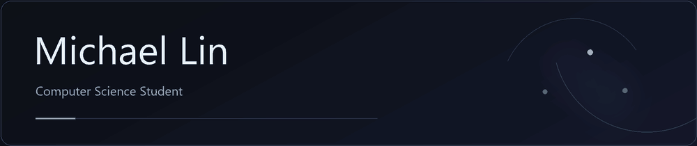
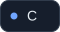
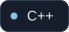
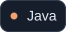
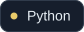
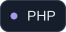
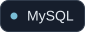
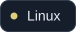
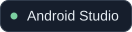
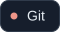

<picture>
  <source media="(max-width: 600px) and (prefers-reduced-motion: reduce)" srcset="./assets/intro-mobile-static.png">
  <source media="(prefers-reduced-motion: reduce)" srcset="./assets/intro-static.png">
  <source media="(max-width: 600px)" srcset="./assets/intro-mobile.gif">
  
</picture>

  <strong>Graduate Student in Computer Science</strong> 
  Taiwan Tech (NTUST) 
  <a href="mailto:michael3858@gmail.com">michael3858@gmail.com</a>

## Languages & Tools

  
  
  
  
  
  
  
  
  

